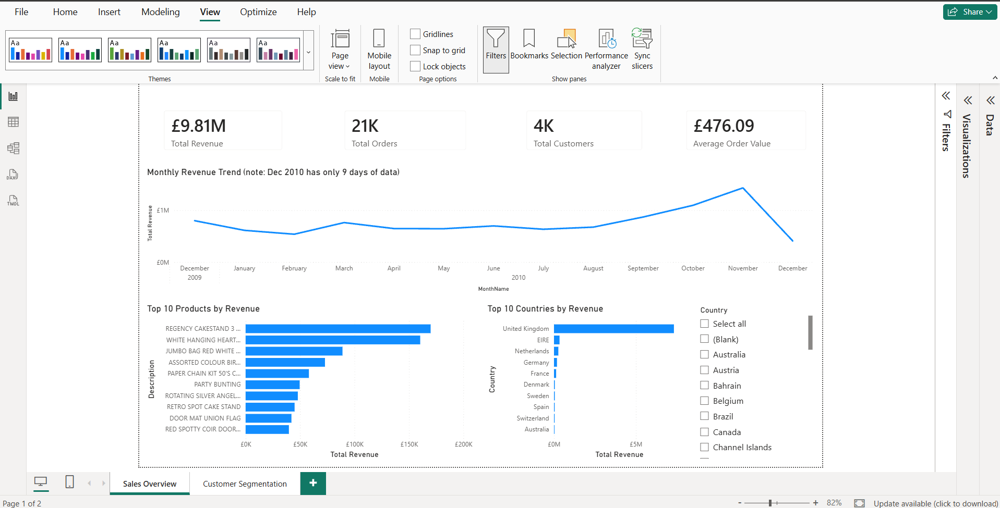

# Retail Data Pipeline & Customer Analytics Platform

An end-to-end analytics project built on the **UCI Online Retail II** dataset: real transactions from a UK-based online retailer, December 2009 to December 2010 (525K+ rows). The project takes raw, messy transaction logs and turns them into a cleaned dataset, a **MySQL star-schema data warehouse**, **SQL-based RFM customer segmentation**, and an **interactive Power BI dashboard**.




---

## Business Questions

1. **Which countries generate the most revenue?** Where should marketing and logistics focus?
2. **Which products sell best, and does "best-selling" even mean one thing?** Ranking by quantity and by revenue give different answers.
3. **Who are the most valuable customers, and which of them are at risk of churning?** Answered with RFM segmentation.

---

## Tools

| Area | Tools |
|---|---|
| Cleaning & EDA | Python, pandas, matplotlib, seaborn (Jupyter) |
| Data warehouse | MySQL (star schema), SQLAlchemy + PyMySQL for loading |
| Analysis | SQL: joins, CTEs, window functions (`NTILE`), views |
| Dashboard | Power BI Desktop (DAX measures, connected to MySQL) |

---

## Pipeline

```
Raw Excel/CSV  →  Python cleaning  →  MySQL star schema  →  SQL analysis + RFM view  →  Power BI dashboard
 (data/raw)        (notebook 01)       (notebook 03 +         (SQL/02, SQL/03)            (.pbix)
                   EDA (notebook 02)    SQL/01_schema.sql)
```

### 1. Data cleaning (`notebooks/01_data_loading_inspection.ipynb`)
- Removed **6,865 fully duplicate rows**.
- Found and fixed **mixed Python types** hidden inside `Invoice` and `StockCode` object columns. They made `.str` methods silently return `NaN` instead of raising an error.
- **Flagged** cancelled orders (`Invoice` starting with "C") instead of deleting them.
- Identified non-product codes (`POST`, `D`, `M`, `DOT`, `ADJUST`, `S`, `B`, `AMAZONFEE`, `GIFT`) by checking their descriptions, not just the code pattern. Real products with unusual codes (`PADS`, `DCGS*`) were kept.
- Recovered **~2,563 missing descriptions** by looking up the same `StockCode` elsewhere in the data. The remaining 365 became "Unknown Product".
- Built an `IsValidSale` flag (not cancelled, not a non-product, price > 0). All revenue figures use only valid sales.
- Kept rows with a missing `Customer ID` for product and country analysis. Customer-level analysis uses a separate subset.

### 2. Exploratory analysis (`notebooks/02_eda.ipynb`)
- Monthly revenue trend, with a data-completeness check: **December 2010 contains only 9 days of data**, so the final dip is not a real decline.
- Top products by quantity vs. by revenue (the two rankings differ).
- Revenue by country, with and without the UK.

### 3. Data warehouse (`SQL/01_schema.sql`, `notebooks/03_load_warehouse.ipynb`)
Star schema in MySQL:

| Table | Type | Rows |
|---|---|---|
| `fact_sales` | Fact (one row per invoice line) | 518,596 |
| `dim_customer` | Dimension | 4,383 |
| `dim_product` | Dimension | 4,632 |
| `dim_date` | Dimension (`YYYYMMDD` integer key) | 307 |

- Surrogate keys for customer and product dimensions.
- `DECIMAL` (not `FLOAT`) for all money columns.
- Verified **0 orphaned foreign keys** with LEFT JOIN / IS NULL checks.

### 4. SQL analysis & RFM segmentation (`SQL/02_rfm_analysis.sql`, `SQL/03_create_rfm_view.sql`)
- **Recency** = days since last purchase, **Frequency** = distinct invoices, **Monetary** = total spend.
- Each customer is scored 1–4 on each metric with `NTILE(4)` inside CTEs, then assigned a segment with a `CASE` statement.
- Saved as the view `vw_customer_rfm`, so Power BI uses the same scoring logic instead of re-implementing it in DAX.

### 5. Power BI dashboard (`Retail_Analytics_Dashboard.pbix`)
- **Sales Overview:** KPI cards (revenue, orders, customers, average order value), monthly revenue trend, top 10 products, top 10 countries, country slicer.
- **Customer Segmentation:** customers per segment, average spend per segment, segment slicer, and a customer-level table sorted by spend.
- DAX measures filter on `IsValidSale`, so dashboard figures match the SQL and Python results.

---

## Key Findings

- **Total valid revenue: £9.81M** from ~21K orders, with an average order value of **£476**.
- **The UK dominates revenue**, as expected for a UK retailer. Excluding the UK, the top international markets are **EIRE, Netherlands, Germany and France**.
- **"Best-selling" depends on the metric:** *Regency Cakestand 3 Tier* is the #1 product by revenue but is not in the top 10 by quantity.
- **RFM segments (4,286 customers with at least one valid purchase):**

| Segment | Customers | Avg. spend |
|---|---|---|
| Champions | 1,265 | £4,943 |
| At Risk | 524 | £2,342 |
| New/Occasional | 666 | — |
| Others | 1,831 | — |

- **Business action:** the **524 At Risk customers** have proven high value but haven't purchased recently. They are a stronger target for a win-back campaign than acquiring new customers.

---

## Notes & Limitations

- The dataset has **no cost data**, so this project measures **revenue, not profit**.
- About 108K transactions have no `Customer ID`. They count towards total revenue, but in the warehouse their country cannot be linked through `dim_customer`, so the country chart covers identified customers only.
- Orchestration (e.g. Apache Airflow) is not included. The pipeline stages run manually. Wrapping them as scheduled tasks is the natural next step.

---

## Project Structure

```
retail-analytics-project/
├── data/
│   ├── raw/                  # original dataset (not tracked in git — see below)
│   └── processed/            # cleaned CSVs (not tracked in git)
├── notebooks/
│   ├── 01_data_loading_inspection.ipynb
│   ├── 02_eda.ipynb
│   └── 03_load_warehouse.ipynb
├── SQL/
│   ├── 01_schema.sql
│   ├── 02_rfm_analysis.sql
│   └── 03_create_rfm_view.sql
├── docs/
│   ├── images/               # dashboard screenshots
│   ├── PROJECT_MASTER_GUIDE.md
│   └── day2_learning_notes.md
├── Retail_Analytics_Dashboard.pbix
└── README.md
```

---

## How to Reproduce

1. Download the dataset from the [UCI Machine Learning Repository: Online Retail II](https://archive.ics.uci.edu/dataset/502/online+retail+ii) and place `online_retail_II.xlsx` in `data/raw/` (the project uses the `Year 2009-2010` sheet).
2. Install the Python packages: `pandas`, `matplotlib`, `seaborn`, `sqlalchemy`, `pymysql`, `openpyxl`.
3. Run `notebooks/01_data_loading_inspection.ipynb` to produce the cleaned CSVs, then `02_eda.ipynb` for the analysis.
4. In MySQL, run `SQL/01_schema.sql` to create the `retail_analytics` database and tables.
5. Update the database connection string in `notebooks/03_load_warehouse.ipynb` with your own MySQL credentials, then run it to load the warehouse.
6. Run `SQL/02_rfm_analysis.sql` and `SQL/03_create_rfm_view.sql`.
7. Open `Retail_Analytics_Dashboard.pbix` in Power BI Desktop (requires the MySQL Connector/NET driver for refresh).

---

## Data Source

Chen, D. (2019). *Online Retail II* [Dataset]. UCI Machine Learning Repository. https://doi.org/10.24432/C5CG6D
