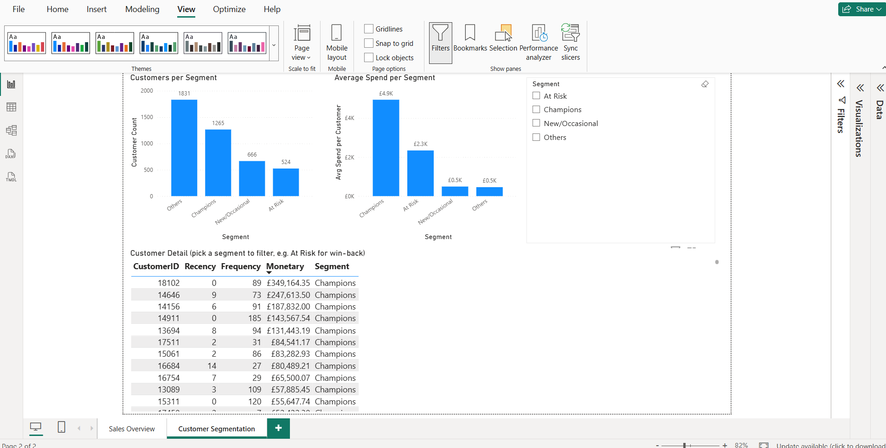

# Retail Data Pipeline & Customer Analytics Platform

An end-to-end data pipeline built on the **UCI Online Retail II** dataset: real transactions from a UK-based online retailer, December 2009 to December 2010 (525K+ rows). A **Python ETL pipeline** cleans the raw transaction logs and loads a **MySQL star-schema data warehouse**, guarded by **automated data quality checks** and **unit tests**, orchestrated with **Apache Airflow** and packaged with **Docker Compose**. On top of the warehouse sit **SQL-based RFM customer segmentation** and an **interactive Power BI dashboard**.




---

## Business Questions

1. **Which countries generate the most revenue?** Where should marketing and logistics focus?
2. **Which products sell best, and does "best-selling" even mean one thing?** Ranking by quantity and by revenue give different answers.
3. **Who are the most valuable customers, and which of them are at risk of churning?** Answered with RFM segmentation.

---

## Tools

| Area | Tools |
|---|---|
| ETL pipeline | Python, pandas, SQLAlchemy + PyMySQL (`src/retail_pipeline/`) |
| Data warehouse | MySQL 8 (star schema) |
| Data quality & testing | Automated quality gate (row counts, referential integrity, revenue reconciliation), pytest |
| Orchestration | Apache Airflow (DAG with one task per stage, retries) |
| Packaging | Docker, Docker Compose (MySQL + pipeline + Airflow) |
| Analysis | SQL: joins, CTEs, window functions (`NTILE`), views |
| Exploration | Jupyter notebooks, matplotlib, seaborn |
| Dashboard | Power BI Desktop (DAX measures, connected to MySQL) |

---

## Architecture

```
 data/raw (Excel)
      │
      ▼
 EXTRACT  ──►  TRANSFORM  ──►  LOAD (full refresh)  ──►  QUALITY GATE  ──►  RFM VIEW  ──►  Power BI
 extract.py    transform.py    load.py                    quality.py         SQL/03          .pbix
               (cleaning        dim_customer, dim_product, (stops the run
                rules)          dim_date, fact_sales       if data is wrong)

 Orchestrated by Airflow:  create_schema → extract_transform → load_warehouse → data_quality_checks → refresh_rfm_view
 Packaged with Docker Compose:  mysql  +  pipeline  +  airflow
```

The notebooks are where the data was explored and the cleaning rules were decided; `src/retail_pipeline/` is the production version of the same logic.

### Data engineering layer

- **Python modules, not notebooks:** `extract.py`, `transform.py` (one tested function per cleaning rule), `load.py`, `quality.py`, `run_pipeline.py`.
- **Configuration from environment variables:** database credentials and paths come from `.env` (git-ignored; `.env.example` is the template). No secrets or machine-specific paths in code.
- **Idempotent loads:** tables are truncated and reloaded (full refresh), the schema uses `CREATE TABLE IF NOT EXISTS`, and the RFM view uses `CREATE OR REPLACE VIEW`. Running the pipeline twice gives the same result as running it once.
- **Data quality gate:** after every load, the pipeline checks row counts, orphaned foreign keys, dimension uniqueness, price validity, and that revenue in MySQL reconciles with revenue computed in pandas. Any failure raises an error and stops the run, so bad data never reaches the dashboard.
- **Unit tests:** `tests/test_transform.py` checks each cleaning rule on a small hand-made dataset (`pytest`).
- **Airflow DAG:** `airflow/dags/retail_pipeline_dag.py` runs each stage as its own task, with 2 retries, on a daily schedule.
- **Docker Compose:** MySQL (with a healthcheck), the one-off pipeline container, and Airflow start with one command.

Every pipeline run reproduces the original analysis exactly: 525,461 raw rows → 518,596 cleaned rows, 4,383 customers, 4,632 products, 307 dates, £9,813,681.39 valid revenue.

### 1. Data cleaning (`notebooks/01_data_loading_inspection.ipynb`)
- Removed **6,865 fully duplicate rows**.
- Found and fixed **mixed Python types** hidden inside `Invoice` and `StockCode` object columns. They made `.str` methods silently return `NaN` instead of raising an error.
- **Flagged** cancelled orders (`Invoice` starting with "C") instead of deleting them.
- Identified non-product codes (`POST`, `D`, `M`, `DOT`, `ADJUST`, `S`, `B`, `AMAZONFEE`, `GIFT`) by checking their descriptions, not just the code pattern. Real products with unusual codes (`PADS`, `DCGS*`) were kept.
- Recovered **~2,563 missing descriptions** by looking up the same `StockCode` elsewhere in the data. The remaining 365 became "Unknown Product".
- Built an `IsValidSale` flag (not cancelled, not a non-product, price > 0). All revenue figures use only valid sales.
- Kept rows with a missing `Customer ID` for product and country analysis. Customer-level analysis uses a separate subset.

### 2. Exploratory analysis (`notebooks/02_eda.ipynb`)
- Monthly revenue trend, with a data-completeness check: **December 2010 contains only 9 days of data**, so the final dip is not a real decline.
- Top products by quantity vs. by revenue (the two rankings differ).
- Revenue by country, with and without the UK.

### 3. Data warehouse (`SQL/01_schema.sql`, `notebooks/03_load_warehouse.ipynb`)
Star schema in MySQL:

| Table | Type | Rows |
|---|---|---|
| `fact_sales` | Fact (one row per invoice line) | 518,596 |
| `dim_customer` | Dimension | 4,383 |
| `dim_product` | Dimension | 4,632 |
| `dim_date` | Dimension (`YYYYMMDD` integer key) | 307 |

- Surrogate keys for customer and product dimensions.
- `DECIMAL` (not `FLOAT`) for all money columns.
- Verified **0 orphaned foreign keys** with LEFT JOIN / IS NULL checks.

### 4. SQL analysis & RFM segmentation (`SQL/02_rfm_analysis.sql`, `SQL/03_create_rfm_view.sql`)
- **Recency** = days since last purchase, **Frequency** = distinct invoices, **Monetary** = total spend.
- Each customer is scored 1–4 on each metric with `NTILE(4)` inside CTEs, then assigned a segment with a `CASE` statement.
- Saved as the view `vw_customer_rfm`, so Power BI uses the same scoring logic instead of re-implementing it in DAX.

### 5. Power BI dashboard (`Retail_Analytics_Dashboard.pbix`)
- **Sales Overview:** KPI cards (revenue, orders, customers, average order value), monthly revenue trend, top 10 products, top 10 countries, country slicer.
- **Customer Segmentation:** customers per segment, average spend per segment, segment slicer, and a customer-level table sorted by spend.
- DAX measures filter on `IsValidSale`, so dashboard figures match the SQL and Python results.

---

## Key Findings

- **Total valid revenue: £9.81M** from ~21K orders, with an average order value of **£476**.
- **The UK dominates revenue**, as expected for a UK retailer. Excluding the UK, the top international markets are **EIRE, Netherlands, Germany and France**.
- **"Best-selling" depends on the metric:** *Regency Cakestand 3 Tier* is the #1 product by revenue but is not in the top 10 by quantity.
- **RFM segments (4,286 customers with at least one valid purchase):**

| Segment | Customers | Avg. spend |
|---|---|---|
| Champions | 1,265 | £4,943 |
| At Risk | 524 | £2,342 |
| New/Occasional | 666 | — |
| Others | 1,831 | — |

- **Business action:** the **524 At Risk customers** have proven high value but haven't purchased recently. They are a stronger target for a win-back campaign than acquiring new customers.

---

## Notes & Limitations

- The dataset has **no cost data**, so this project measures **revenue, not profit**.
- About 108K transactions have no `Customer ID`. They count towards total revenue, but in the warehouse their country cannot be linked through `dim_customer`, so the country chart covers identified customers only.
- **A data quality catch:** on its first run, the quality gate flagged 14 "valid" sales with a price of 0 in MySQL. The cause was 14 sales of *PADS TO MATCH ALL CUSHIONS* priced at £0.001, which the original `DECIMAL(10,2)` price column silently rounded to £0.00. Price columns now use 3 decimal places.
- Loads are a full refresh, which suits a static historical file of ~0.5M rows. A daily feed would call for incremental loading using a watermark on `InvoiceDate`.
- Airflow runs in `standalone` mode (single container), which fits a single-machine project. A production deployment would use a separate metadata database and a distributed executor.

---

## Project Structure

```
retail-analytics-project/
├── data/
│   ├── raw/                  # original dataset (not tracked in git — see below)
│   └── processed/            # cleaned CSVs (not tracked in git)
├── src/retail_pipeline/      # production pipeline
│   ├── config.py             # settings from environment variables / .env
│   ├── extract.py            # read raw Excel
│   ├── transform.py          # cleaning rules (one function per rule)
│   ├── load.py               # star schema build + idempotent full-refresh load
│   ├── quality.py            # data quality gate
│   └── run_pipeline.py       # runs every stage end to end
├── tests/
│   └── test_transform.py     # pytest unit tests for the cleaning rules
├── airflow/
│   ├── Dockerfile            # Airflow image + pipeline dependencies
│   └── dags/retail_pipeline_dag.py
├── SQL/
│   ├── 01_schema.sql         # star schema (idempotent)
│   ├── 02_rfm_analysis.sql   # RFM analysis queries
│   ├── 03_create_rfm_view.sql
│   └── 04_data_quality_checks.sql
├── notebooks/                # exploration: where the cleaning rules were decided
│   ├── 01_data_loading_inspection.ipynb
│   ├── 02_eda.ipynb
│   └── 03_load_warehouse.ipynb
├── docs/
│   ├── images/               # dashboard screenshots
│   ├── PROJECT_MASTER_GUIDE.md
│   └── day2_learning_notes.md
├── Dockerfile                # pipeline image
├── docker-compose.yml        # mysql + pipeline + airflow
├── requirements.txt
├── .env.example              # copy to .env (git-ignored) and set a password
├── Retail_Analytics_Dashboard.pbix
└── README.md
```

---

## How to Run

**1. Get the data.** Download the dataset from the [UCI Machine Learning Repository: Online Retail II](https://archive.ics.uci.edu/dataset/502/online+retail+ii) and place `online_retail_II.xlsx` in `data/raw/` (the pipeline uses the `Year 2009-2010` sheet).

**2. Configure.** Copy `.env.example` to `.env` and set `DB_PASSWORD`.

**3a. Run with Docker (recommended).**

```bash
docker compose run --rm pipeline      # starts MySQL, runs the full pipeline once
docker compose up -d airflow          # starts Airflow at http://localhost:8080
```

In the Airflow UI, un-pause and trigger the `retail_pipeline` DAG. The admin password appears in `docker compose logs airflow`. The warehouse is reachable from Power BI or MySQL Workbench at `localhost:3307`.

**3b. Run locally (without Docker).** Point `DB_HOST`/`DB_PORT`/`DB_PASSWORD` in `.env` at your own MySQL server, then:

```bash
pip install -r requirements.txt
PYTHONPATH=src python -m retail_pipeline.run_pipeline      # PowerShell: $env:PYTHONPATH="src"
```

**4. Run the tests.**

```bash
pytest
```

**5. Dashboard.** Open `Retail_Analytics_Dashboard.pbix` in Power BI Desktop (requires the MySQL Connector/NET driver to refresh).

---

## Data Source

Chen, D. (2019). *Online Retail II* [Dataset]. UCI Machine Learning Repository. https://doi.org/10.24432/C5CG6D
